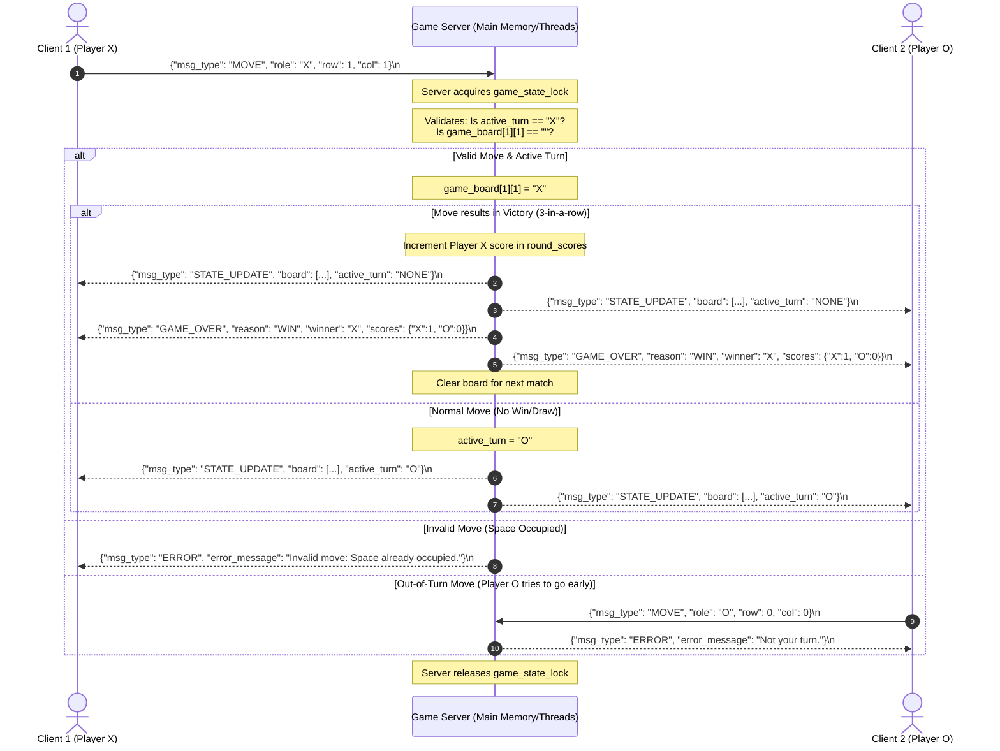

# State Synchronization & Mermaid Sequence Diagram

This sequence diagram shows the round-trip flow of a Tic-Tac-Toe move based on my protocol blueprint. It models successful moves, out-of-turn rejections, board space validations, and synchronous broadcasts.

